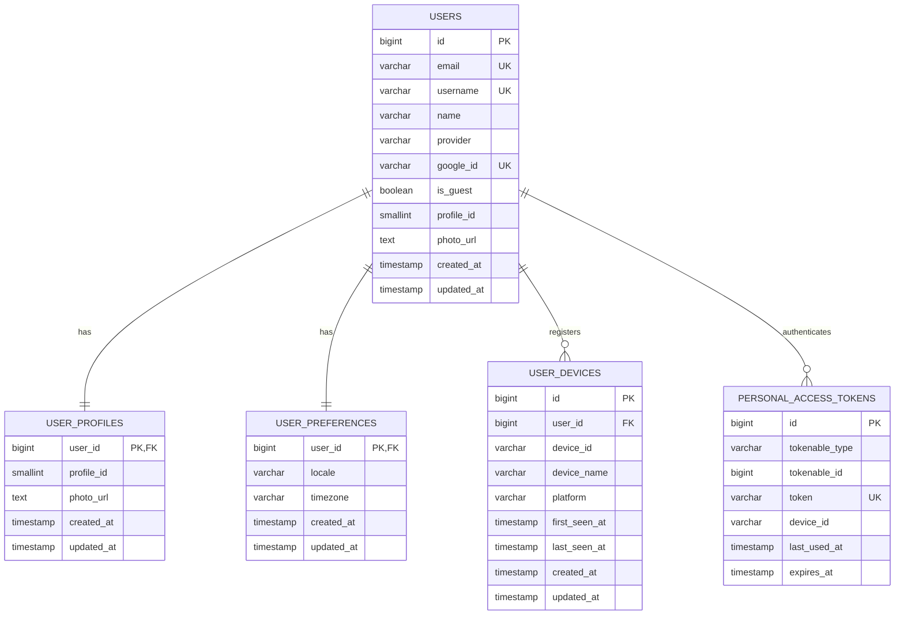

# Phase 05 — ERD and Data Dictionary

**Status:** Design baseline for implementation; CI verification pending.
**Scope:** Account identity, profile fields, account preferences, and known device installations. This document does not define the later library/sync domains.

## 1. Entity relationship diagram

Relationship rules:
- `user_profiles.user_id` is both primary key and FK to `users.id`, with ON DELETE CASCADE.
- `user_preferences.user_id` is both primary key and FK to `users.id`, with ON DELETE CASCADE.
- `user_devices.user_id` is FK to `users.id`, with ON DELETE CASCADE; unique key `(user_id, device_id)` prevents a duplicate installation for one account.
- `personal_access_tokens` remains Laravel Sanctum's polymorphic token/session table. It is not the device registry and is not replaced by `user_devices`.
- No Phase 05 table is created for movies, episodes, bookmarks, playlists, watch history, wellness, billing, or media metadata.

## 2. Data dictionary

| Entity / column | Type | Meaning and constraints |
|---|---|---|
| `users.id` | bigint | Existing account primary key; preserved unchanged. |
| `users.profile_id` | integer | Legacy Android-compatible profile image identifier; default 0. |
| `users.photo_url` | text nullable | Legacy Android-compatible photo URL; preserved and mirrored into `user_profiles`. |
| `user_profiles.user_id` | bigint PK/FK | One profile row per account; cascades when account is deleted. |
| `user_profiles.profile_id` | smallint unsigned | Profile image identifier copied from `users.profile_id`; default 0. |
| `user_profiles.photo_url` | text nullable | Profile photo URL copied from `users.photo_url`. |
| `user_preferences.user_id` | bigint PK/FK | One account preferences row per account; cascades on account deletion. |
| `user_preferences.locale` | varchar(16) nullable | BCP-47-like locale tag validated by the API; null means use app/device default. |
| `user_preferences.timezone` | varchar(64) | IANA timezone identifier; defaults to `UTC`; presentation preference only. |
| `user_devices.id` | bigint | Device registry primary key. |
| `user_devices.user_id` | bigint FK | Account owner; cascade delete. |
| `user_devices.device_id` | varchar(64) | Stable installation identifier provided by Flutter; unique within one account. |
| `user_devices.device_name` | varchar(100) nullable | Human-readable device label supplied by the app. |
| `user_devices.platform` | varchar(16) nullable | Current app values: android, ios, tv. |
| `user_devices.first_seen_at` | timestamp | First observed sign-in for this owner/device pair. |
| `user_devices.last_seen_at` | timestamp | Most recent observed sign-in for this owner/device pair. |
| `created_at`, `updated_at` | timestamp | Laravel timestamps; application-generated values use UTC. |

## 3. Compatibility and ownership

- `users` remains the source of account identity and authentication. This phase does not replace account IDs, provider identity, Google identity, password hashes, or Sanctum sessions.
- Existing Android profile JSON continues to read `profile_id` and `photo_url` from `users`; profile writes mirror those fields into `user_profiles` in the same transaction.
- Registration accepts optional `photo_url` and `profile_id` and persists them without changing the existing response envelope.
- All reads/writes of preferences, profile export, and devices are scoped through the authenticated `User` relationship or the authenticated user ID. A client-supplied owner ID is never used to select another user's data.
- Device registration is tied to the stable Flutter installation ID. The `user_devices` registry is informational and does not introduce a plan-based device limit.

## 4. Time and identifier semantics

- Persisted timestamps are UTC instants. No per-user timezone is applied to DB connections, SQL session timezone, or server clock.
- `user_preferences.timezone` stores an IANA identifier used by clients for presentation.
- `user_devices.device_id` remains an opaque installation identifier (Flutter currently sends a UUID); never use it as a global identity or expose a user's devices to another account.
- Future media identity should use `(metadata_provider, media_type, external_id)` and keep `external_id` as a string so source IDs are not coerced or truncated. That future key is documentation only; Phase 05 does not create a media table.

## 5. Migration and deletion behavior

- Migration 2026_11_22_000007 creates tables only when absent, checks the expected columns and owner constraints, and backfills in batches of 500.
- Existing user profile values are copied with `insertOrIgnore`; existing preferences are left untouched; known devices are aggregated from Sanctum token metadata and upserted by owner/device.
- Existing tables are rejected if the owner FK/cascade or required unique/primary key is missing. A column-only partial table is not accepted.
- Migration rollback is deliberately non-destructive. The migration does not drop profile, preference, or device records.
- Existing account deletion removes Sanctum and temporary auth tokens, and the new owner FKs cascade profile/preferences/device rows. No production deletion/migration was performed in this phase.